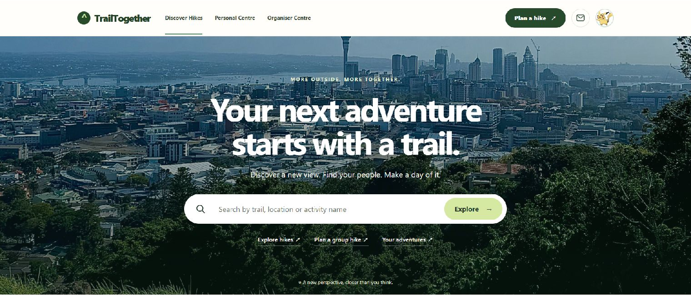
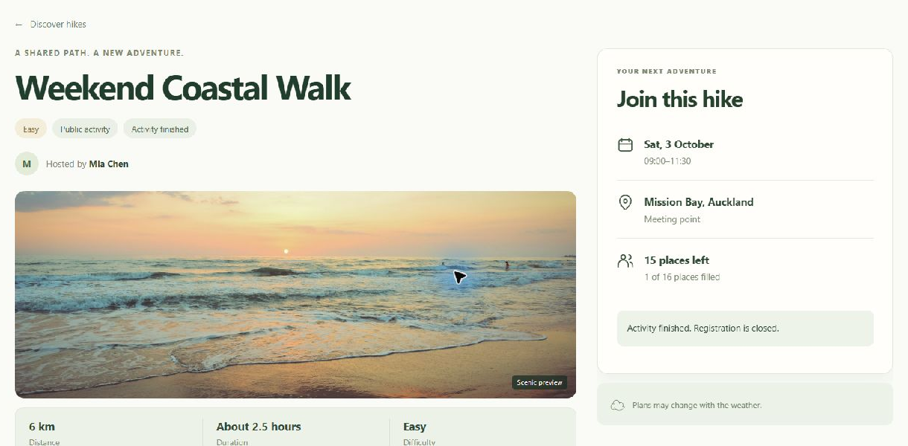
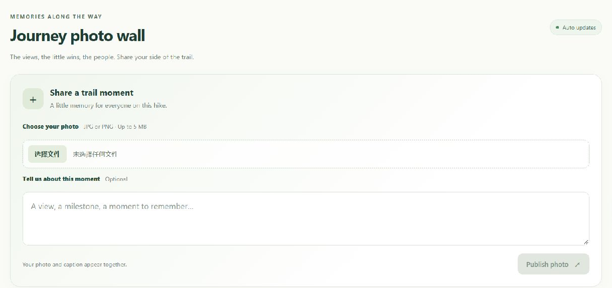

# TrailTogether

### Explore the trails. Find your people.

**Outdoor activity platform · Web + Java desktop · University of Auckland team project**

TrailTogether brings activity discovery, participant communication, shared photos, and event-day attendance into one application. A SvelteKit web experience helps people explore outdoor activities, while a Java Swing Door Station supports the practical work of welcoming guests and recording attendance.

## Application preview

### Discover your next adventure



A clear entry point for finding trails and exploring group activities.

### Explore the activity details



Route information, difficulty, meeting arrangements, available places, and registration status in one view. The displayed sample activity has finished.

### Share a trail moment



Image upload and an optional caption bring shared memories into the activity experience. This screenshot shows the submission form; participant-uploaded photos and comments are excluded.

Screenshots were captured from the local application. Browser controls and unrelated personal information have been cropped out. The organiser name belongs to a seeded demo account.

## Project highlights

### A connected activity experience

The homepage and activity detail pages provide a starting point for discovering outdoor events and exploring their details. Participant-facing pages, invitation links, and event emails connect the browsing experience with the next steps in an activity.

### Shared memories through the Photo Wall

An activity photo gallery brings participant photos into the event experience, giving people a place to revisit and share memories from their activities.

### Invitations and confirmation emails

Email functionality supports invitations and registration confirmations, with links that lead back to the relevant activity or personal invitation. Confirmation messages can include a check-in QR code and a manual code for arrival at the event.

### A desktop Door Station for event staff

The Java Swing client provides an attendance interface alongside the web application. Staff can scan or enter a check-in code, or filter the guest list and check in a selected guest.

Guest search supports names, check-in codes, and registration numbers. This gives staff a practical alternative when a participant cannot present a QR code.

### Attendance workflows that tolerate interrupted connectivity

The Door Station caches the guest list and queues check-ins locally until the server confirms them. Cached guest search remains available offline, and pending attendance records can be synchronised when connectivity returns.

### Name badges from the guest list

After a guest's check-in is confirmed by the server, staff can preview a 90 × 55 mm name badge and open the operating system's print dialog. The badge includes the guest name and event title, with text wrapping and sizing for longer entries.

The preview and printable output use the same drawing logic. Printing supports the system's available printers, including an installed PDF printer.

### Organiser-controlled station access

An organiser pairs a Door Station using a single-use code with a limited lifetime. Station identity persists between desktop sessions, and organisers can revoke station access from the web interface.

## Typical journeys

| Participant | Event staff |
| :--- | :--- |
| Discover an outdoor activity | Pair a Door Station with an event |
| Explore activity details | Download and search the guest list |
| Receive an invitation or confirmation email | Scan a code or select a guest |
| Present a check-in code on arrival | Record check-in and synchronise attendance |
| View or share activity photos | Preview and print a confirmed guest's badge |

## Technology stack

| Layer | Technologies | Purpose |
| :--- | :--- | :--- |
| Web application | Svelte, SvelteKit, JavaScript, Vite | Activity discovery, detail pages, photos, and organiser interfaces |
| Backend | Node.js, Express | Application APIs and server-side workflows |
| Database | SQLite | Persistent application data |
| Email | Nodemailer | Invitations and confirmation messages |
| Desktop application | Java 17, Swing | Guest search, attendance, and name-badge preparation |
| Printing | Java AWT printing API | Badge preview and system printing integration |

## Architecture at a glance

```text
SvelteKit web application ──┐
                           ├── Express API ── SQLite
Java Swing Door Station ───┘        │
       │                           └── Email delivery via Nodemailer
       ├── Cached guest list
       ├── Pending check-in queue
       └── Badge preview → System print dialog
```

## Engineering strengths

- **Web and desktop integration:** Browser and desktop clients support different parts of the same event workflow.
- **Offline attendance support:** Local caching and queued check-ins accommodate temporary connectivity interruptions.
- **Multiple check-in paths:** QR/manual codes and guest selection provide alternatives at the welcome desk.
- **Connected communication:** Email links bridge participant messages and the relevant application pages.
- **Reusable badge rendering:** Shared drawing logic keeps badge preview and printable output consistent.

## My contributions

Within the team project, I worked on the following areas:

| Area | Contribution |
| :--- | :--- |
| **Homepage** | Built the homepage and activity discovery interface. |
| **Activity detail page** | Developed the page presenting individual activities and their details. |
| **Photo gallery / Photo Wall** | Implemented the activity photo gallery experience. |
| **Email functionality** | Worked on invitation and confirmation emails, including links to the relevant activity or personal invitation. |
| **Door Station guest selection and check-in** | Added guest filtering, guest selection, and check-in for the selected guest in the Java desktop interface. |
| **Name-badge printing** | Added selected-guest badge preview and printing through the operating system print dialog. |

These contributions form part of a collaboratively developed application; the project highlights above describe the team's overall product.

## About this repository

TrailTogether was developed as a University of Auckland PGCertIT team project. This repository presents the application as a portfolio case study and describes project-level capabilities.

The portfolio contains documentation only. Application source code, credentials, participant records, and confidential screenshots are not included. The features described reflect the inspected local implementation; this page does not establish which changes have been merged into the team's remote repository.

Physical printer output and PDF saving require verification on the intended computer. No production deployment, usage metrics, or performance benchmarks are claimed.

---

Portfolio profile: [zhou89137-cell](https://github.com/zhou89137-cell)
